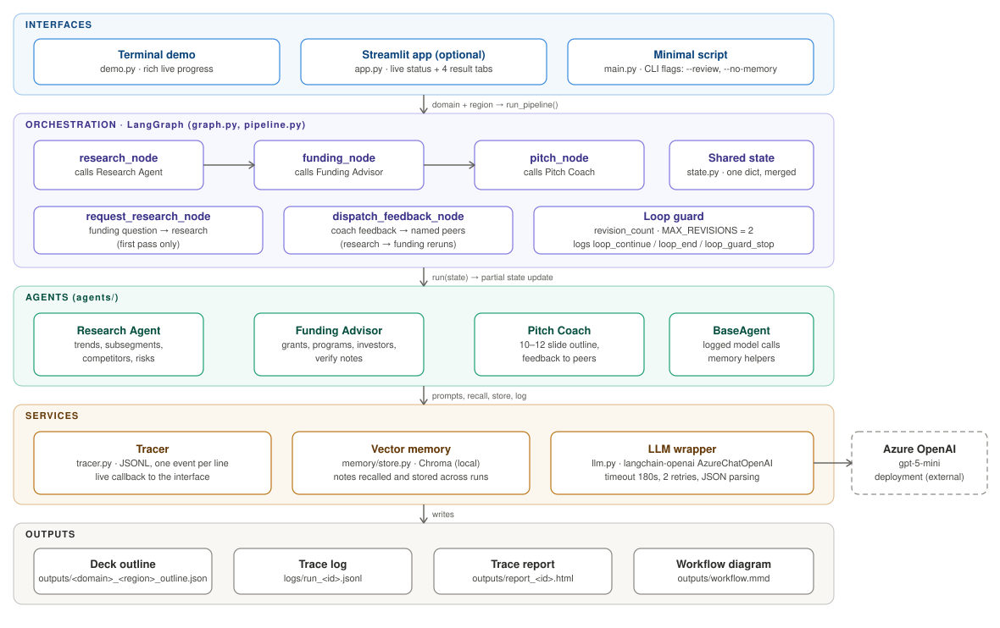
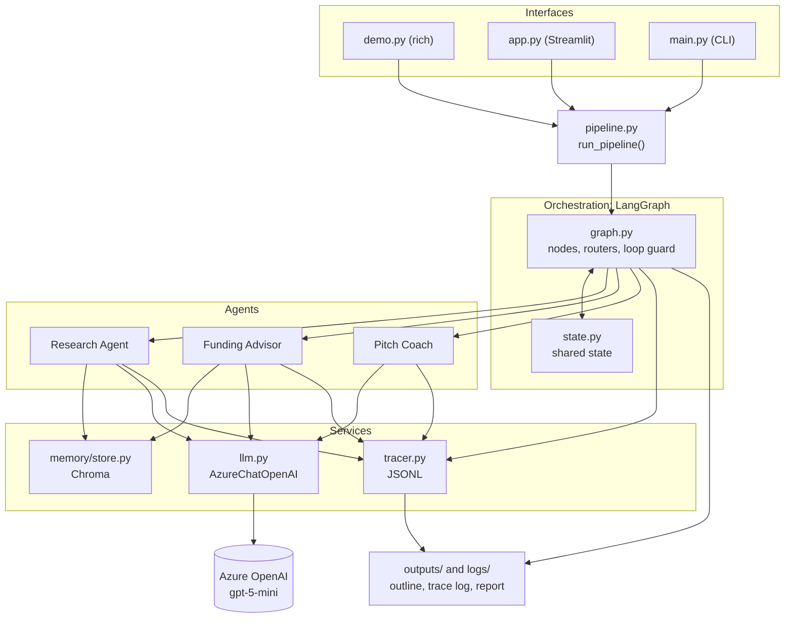
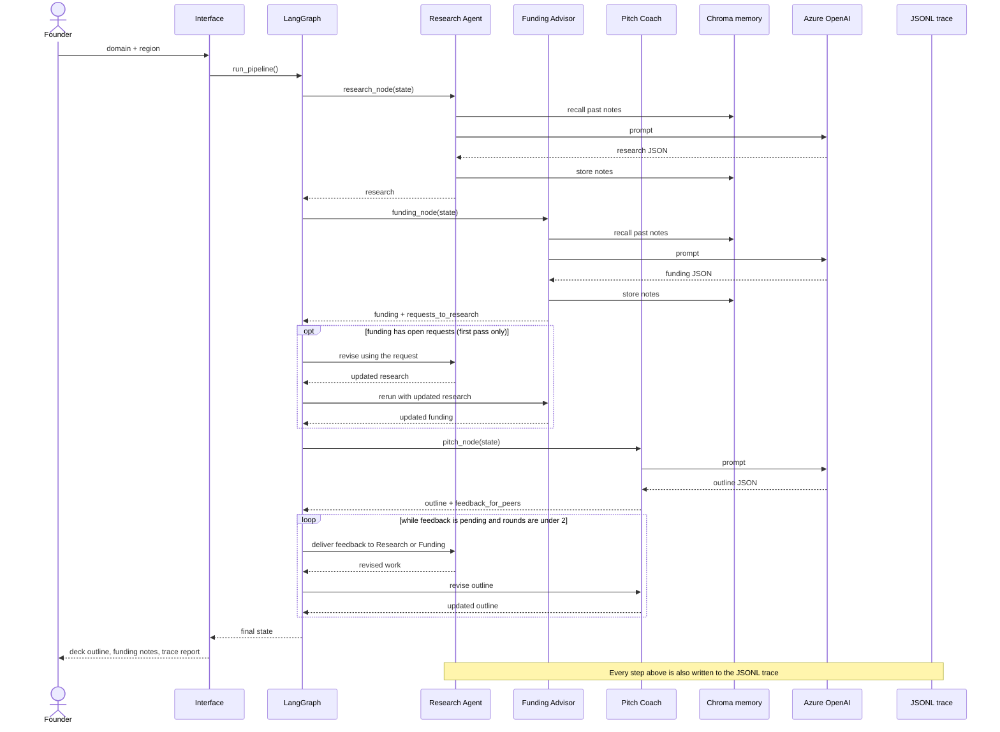
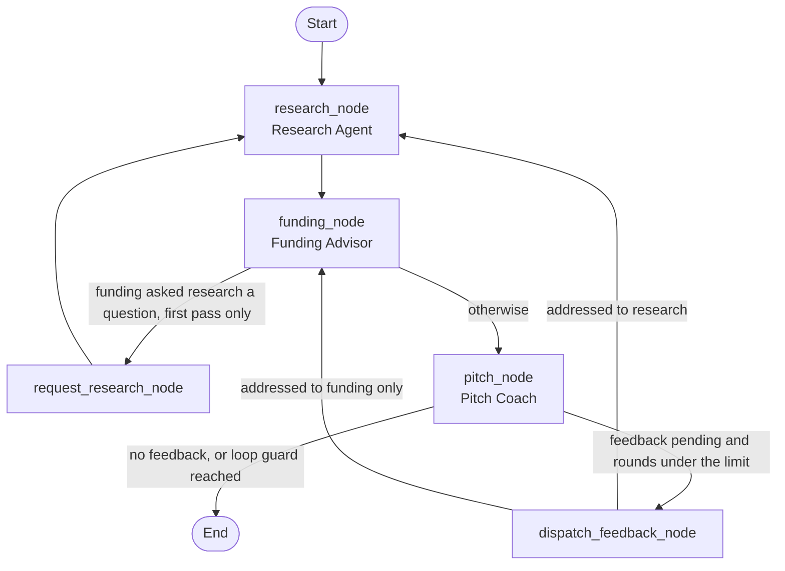

# Multi-Agent Workflow Planner for a Startup Accelerator

Project: Multi-Agent Orchestration

A team of three role-based AI agents (Research Agent, Funding Advisor, Pitch Coach) that takes a startup **domain** and **region** and produces a founder-ready **pitch deck outline**. The agents hand context to each other, ask each other for revisions through feedback loops, reuse insights from earlier runs through vector memory, and leave a full trace that explains how the final outline was reached.

---

## 1. Quick start

### Requirements

- Python 3.10 to 3.12
- An Azure OpenAI deployment (developed and tested with `gpt-5-mini`)
- Internet access on first run (Chroma downloads a small local embedding model, about 80 MB)

### Setup

```bash
conda create -n myenv_10 python=3.12
conda activate myenv_10
pip install -r requirements.txt
```

### Run the demo

```bash
python demo.py fintech US --review
```

This is the recommended demo command. It prints live progress as agents hand off work, shows the final deck outline, and writes an HTML trace report. `--review` guarantees one visible feedback round (see section 5).

Other ways to run it:

| Command | What it does |
|---|---|
| `python demo.py fintech US` | Normal run. Feedback loops fire only when an agent actually asks for something. |
| `python demo.py` | Interactive prompts for domain and region. |
| `python demo.py healthtech EU --no-memory` | Same run with vector memory disabled (for before/after comparison). |
| `streamlit run app.py` | Optional web interface with live progress and four tabs: deck, funding options, research, agent trace. |
| `python main.py fintech US` | Minimal script version without the rich display. |

A run takes about 3 minutes with no feedback rounds and up to about 5 minutes with the maximum number of rounds (3 to 9 model calls).

### Inspect a run

```bash
python show_trace.py          # event-by-event trace of the newest log, with timings
python report.py              # narrative plus HTML report for the newest log
python show_memory.py "fintech payments"   # what the vector memory holds
```

---

## 2. Technology stack and architecture

### Technology stack

| Area | Technology | Used for |
|---|---|---|
| Language | Python 3.10 to 3.12 (developed on 3.12) | Everything |
| Orchestration | LangGraph | `StateGraph` with agent nodes, routing nodes, conditional edges, and the loop guard |
| State | Python `TypedDict` | The shared state schema that LangGraph merges agent updates into |
| LLM access | `langchain-openai` (`AzureChatOpenAI`), `langchain-core` | Calling the model, with timeout and retry settings |
| Model | Azure OpenAI `gpt-5-mini` | Reasoning model behind all three agents |
| Vector memory | ChromaDB (`PersistentClient`, cosine distance, default local embedding model) | Notes stored and recalled across runs |
| Configuration | `python-dotenv` | Reads credentials from `.env` |
| Terminal interface | `rich` | Live progress, tables, and panels in `demo.py` |
| Web interface | Streamlit | Optional page in `app.py` |
| Tracing | Custom `Tracer` writing JSONL (standard-library `json`) | Interaction history, reasoning paths, handoffs, memory events |
| Reporting | Plain Python generating self-contained HTML and CSS | The trace report in `report.py` |
| Diagrams | Mermaid, plus an SVG | Workflow graph and architecture |
| Environment | conda and pip | Environment creation and package installation |

### Architecture overview



The same structure as a Mermaid diagram (renders on GitHub and in most Markdown viewers):



### Sequence of one run



### Workflow graph



The same graph is exported by the program to `outputs/workflow.mmd`.

### Components

| Component | File | Role |
|---|---|---|
| Orchestration | `graph.py` | LangGraph state machine: agent nodes, routing nodes, conditional edges, loop guard |
| Shared state | `state.py` | The single state object passed between agents (`domain`, `region`, `research`, `funding`, `pitch_outline`, `feedback`, `revision_count`, `force_review`) |
| Agents | `agents/` | `ResearchAgent`, `FundingAdvisor`, `PitchCoach`, all built on `BaseAgent` |
| LLM wrapper | `llm.py` | The only file that knows about Azure OpenAI. Handles timeouts, retries, empty replies, and JSON extraction. |
| Vector memory | `memory/store.py` | Chroma store that agents write to and recall from across runs |
| Tracing | `tracer.py` | Writes every event to a JSONL log and forwards it to the live display |
| Reporting | `report.py`, `show_trace.py` | Turns a log into a narrative, an HTML report, and a timed event list |
| Interfaces | `demo.py`, `app.py`, `main.py`, `pipeline.py` | Terminal demo, Streamlit page, minimal script, and the shared run function behind them |

---

## 3. Agents: roles and responsibilities

The three roles were scoped so that their responsibilities do not overlap. Each agent's system prompt explicitly names what it must **not** do.

| | Research Agent | Funding Advisor | Pitch Coach |
|---|---|---|---|
| **Responsibility** | Market overview, subsegments, trends, target customers, competitors, opportunities, risks, regulatory notes for the domain and region | Grants, accelerators, competitions, government programs, and investor types that fit the domain and region | Slide-by-slide deck outline (10 to 12 slides) built from the other two outputs, plus a review of those inputs |
| **Reads** | `domain`, `region`, feedback addressed to it, recalled memory | The research output, `region`, feedback addressed to it, recalled memory | Research and funding outputs, feedback addressed to it |
| **Produces** | Structured research JSON | Recommendations with fit reason, estimated range, eligibility, and a "verify" note; `requests_to_research` | Outline with a data source and evidence per slide, `founder_todo`, `feedback_for_peers`, `ready` flag |
| **Must not** | Recommend funding or structure a deck | Do market research or structure a deck | Do new research or look for funding; invent founder facts or numbers |
| **Memory** | Stores and recalls trends, subsegments, competitors, risks | Stores and recalls funding options | None (it works only from the current run's outputs) |

Design choices that apply to all agents:

- Every agent returns a **partial state update** (for example `{"research": ...}`), which LangGraph merges into shared state.
- Agents **revise** rather than start over: if feedback addressed to them exists, they are shown their previous output and the feedback.
- The Pitch Coach writes `[Founder to fill: ...]` instead of inventing the team, traction, pricing, or ask amounts, and collects those items in `founder_todo`.
- Each slide records its `data_source` (research, funding, founder, or mixed) and the specific evidence it used, so the deck can be traced back to the agent that supplied it.

---

## 4. Coordination flow

1. The input is a **domain** and **region**.
2. **Research Agent** recalls similar notes from earlier runs, analyses the domain, stores its notes, and hands the result to the Funding Advisor.
3. **Funding Advisor** reads the research (and its own recalled notes), recommends funding options tied to specific research findings, stores them, and may list `requests_to_research` for anything it needs.
4. **Router after funding:** if there are open requests and this is the first pass, the request is sent back to the Research Agent, which revises, and the Funding Advisor then runs again on the improved research.
5. **Pitch Coach** synthesises both outputs into the deck outline and reviews them. It returns `ready: true`, or `ready: false` with up to two feedback items addressed to a peer.
6. **Router after the coach:** pending feedback is delivered to the addressed agent, which revises. If research changed, funding reruns after it. The coach then revises the outline using the updated inputs.
7. The run ends when there is no outstanding feedback or the loop guard is reached. The outline is saved to `outputs/`.

---

## 5. Feedback loops and the loop guard

There are two feedback paths:

| Path | Trigger | Route |
|---|---|---|
| Funding to Research | The Funding Advisor returns a non-empty `requests_to_research` | Research revises, then Funding reruns. Only on the first pass. |
| Coach to peers | The Pitch Coach returns feedback items for `research_agent` or `funding_advisor` | The addressed agent revises (Research is followed by Funding), then the Coach revises the outline |

Safeguards:

- **`revision_count` with `MAX_REVISIONS = 2`** stops the loop from running indefinitely. When the limit stops a loop that still has feedback pending, the orchestrator logs `loop_guard_stop`.
- **Funding requests are honoured once.** A second funding-to-research request is refused and logged as `funding_requests_skipped`.
- **The `feedback` list is replaced each round**, not appended, so old feedback is never re-applied.
- **Feedback rules in the coach's prompt.** Feedback must be something the receiving agent can answer from general knowledge. It may not ask for live verification, contact details, or founder-only information (those go into `founder_todo`). Without this rule, the first version of the coach produced requests no agent could satisfy.
- **`--review` (demo mode)** forces the coach to send one feedback item on its first pass so a loop is always visible in a demo. It is clearly labelled as a demo option, and normal runs do not use it.

Worst case is about 9 model calls per run.

### Example run

A normal run for `fintech` / `US` made 5 model calls, each between 20 and 40 seconds, and took about 3 minutes. The Funding Advisor's request triggered the funding-to-research loop on its own, and the Pitch Coach marked the outline ready without further feedback.

A `--review` run made 8 model calls. The Funding Advisor's request went to Research and funding reran, the Pitch Coach then sent feedback to the Funding Advisor, the Funding Advisor revised, the Pitch Coach revised the outline, and the run ended with `loop_end` after 2 feedback rounds.

---

## 6. Vector memory

Agents store their findings in a local Chroma collection (`memory_store/`, cosine distance, default local embedding model) and recall them in later runs.

- **What is stored:** small notes, one per research trend, subsegment, competitor, and risk, and one per funding option. Small notes retrieve better than whole JSON documents.
- **Who recalls what:** each agent recalls only its own earlier notes.
- **Current run excluded:** recall ignores notes from the current run, so an agent does not retrieve its own earlier draft during a revision. Revised notes replace that run's earlier version.
- **Relevance filter:** notes farther than `MAX_DISTANCE = 0.75` are dropped. This is an initial value, not a tuned one; every recalled note's distance is logged so it can be tuned from real data.
- **Notes are labelled as unverified** in the prompt, with their domain and region, and the model is told to use a note only if it is relevant to the current domain and region.
- **Failures never crash a run:** memory errors are caught and logged as `store_error` or `recall_error` events.

Observations from testing: [Fill in: what happened in your `fintech India` run after a `fintech US` run (which notes were recalled, their regions and distances, whether any US-only content such as SBIR/STTR appeared in the India output), and what the `agritech` run recalled.]

---

## 7. Logging and reasoning traceability

Every run writes `logs/run_<id>.jsonl`, one JSON object per line.

| Event type | Meaning |
|---|---|
| `input` | What the agent received (domain, region, which upstream agent it received context from) |
| `reasoning` | The full prompt sent to the model and the full response, with call duration |
| `output` | A summary of what the agent produced |
| `handoff` | Which agent the result was passed to. The orchestrator also logs `node_start` and `node_end` around every agent, listing the state keys available and updated. |
| `feedback` | Feedback sent, received, or routed, and the loop decisions (`loop_continue`, `loop_end`, `loop_guard_stop`, `funding_requests_skipped`) |
| `memory` | Notes stored, notes recalled (with distances, kinds, domain, and region), and any memory errors |

`python report.py` converts a log into a terminal narrative and a self-contained HTML report with:

- a flow strip of agent runs (for example `R → F → R → F → C`), with revision rounds shown as subscripts
- a card per step: context received, feedback received, memory used, output, duration, and collapsible prompt and response
- a table of feedback exchanged between agents
- a table of recalled memory notes, marked used or filtered out
- a per-agent contribution table (runs, model calls, model time, feedback sent and received, memory used)

Local structured logging was chosen over LangSmith. It has no external dependency or account requirement, the logs can be submitted with the project, and the report is built directly from them. Because the project uses LangChain and LangGraph, LangSmith tracing could be added later through environment variables.

---

## 8. Why LangGraph

| Framework | Assessment for this project |
|---|---|
| **LangGraph (chosen)** | The workflow is not a straight chain: agents send work back to earlier agents under conditions. LangGraph models this directly with shared state, nodes, and conditional edges, and it can export the graph as a diagram. |
| CrewAI | Simpler role-based setup, but less control over conditional loops and custom guard logic. |
| AutoGen | Conversation-centred. Harder to keep a structured, replayable trace with explicit state handoffs. |

---

## 9. Challenges and trade-offs

**No live data.** The model has no web access, so research and funding content comes from training knowledge. The Research Agent is told to label figures as estimates and never invent precise statistics. The Funding Advisor gives approximate ranges and a "verify" note per recommendation, and those notes are shown in the final output. A concrete example from development: the Funding Advisor recommended SBIR/STTR, but that program's authority lapsed on 30 September 2025 and was reauthorized on 13 April 2026 through 2031. A model with an earlier training cutoff could not know about that gap. Adding a web search tool to the Research and Funding agents is the main improvement for production use.

**Azure setup took the most debugging time.**
- A persistent `404 Resource not found` was eventually resolved by making the `.env` file the single source of truth (`load_dotenv(override=True)`), since other environment variables in a reused conda environment could override the settings.
- `gpt-5-mini` is a reasoning model: it requires `max_completion_tokens` rather than `max_tokens` and does not accept a custom temperature. Hidden reasoning tokens count against the budget, so too small a limit returns an empty reply. The budget is set to 8000 and an empty reply raises a clear error.
- Some runs stalled while waiting for Azure's reply. The cause was not established; it matched an intermittent connection stall. The mitigation is `timeout=180` and `max_retries=2`, so a stuck call now ends in a retry or a clear error. In the final test run every call took 20 to 40 seconds.

**Feedback that cannot be satisfied.** The first Pitch Coach asked peers for things they could not provide (live verification of programs, sample investor contacts, the founder's chosen subsegment). A loop would then produce invented specifics and still not converge. The fix was to constrain feedback to what a peer can answer from general knowledge, and to have the Research Agent return subsegments so that the coach does not need the founder to choose one.

**Region reached only one agent at first.** Review of an early run showed the Research Agent ignoring the region (competitors were global, not regional). The region is now passed to both Research and Funding.

**Trade-offs:**

| Decision | Benefit | Cost |
|---|---|---|
| Loop guard of 2 rounds and one funding request | Bounded cost and time | A second round of refinement is not possible, and a late request can go unanswered |
| `--review` demo mode | A feedback loop is always visible in a demo | Feedback in that mode is partly forced, so normal runs better reflect natural behaviour |
| Memory reused across runs | Faster insight reuse, demonstrates vector memory | Stored notes are unverified model output, so mistakes can compound and notes can leak between regions or domains. Mitigated with labelling, a relevance filter, and domain and region metadata, but not eliminated. |
| JSON output with schema in the prompt | Predictable downstream handoffs | Occasional parse failures are possible; `parse_json` strips code fences and extracts the JSON object |
| Local JSONL tracing | No account needed, easy to submit | No hosted dashboard; the HTML report is custom |
| Coach has no memory | Keeps the deck strictly grounded in the current run's inputs | The deck cannot benefit from past decks |

---

## 10. Limitations and future work

- Add web search for the Research and Funding agents, and cite sources.
- Let the founder supply facts (team, traction, ask), so the placeholders can be filled and the coach can finish the outline.
- Tune `MAX_DISTANCE` and add memory expiry so stale notes age out.
- Score outline quality automatically so loop decisions use more than the coach's own judgement.
- Add LangSmith tracing alongside the local log.
- Stream partial results to the interface and allow cancelling a run.

---

## 11. Project structure

```
startup_planner/
├── agents/
│   ├── base.py            # BaseAgent: logged model calls, memory helpers
│   ├── research.py        # Research Agent
│   ├── funding.py         # Funding Advisor
│   └── pitch_coach.py     # Pitch Coach
├── memory/
│   └── store.py           # Chroma vector memory
├── graph.py               # LangGraph workflow, routers, loop guard
├── state.py               # Shared state definition
├── llm.py                 # Azure OpenAI wrapper
├── tracer.py              # JSONL event logger
├── pipeline.py            # Shared run function for all interfaces
├── report.py              # Trace report (terminal narrative and HTML)
├── demo.py                # Terminal demo
├── app.py                 # Streamlit interface (optional)
├── main.py                # Minimal script
├── show_trace.py          # Timed event list for a log
├── show_memory.py         # Inspect vector memory
├── requirements.txt
├── .env.example
├── docs/
│   └── architecture.svg   # Architecture diagram used in this README
├── sample_outputs/        # Example logs, reports, outlines, workflow diagram
└── README.md
```

### Sample outputs

`sample_outputs/` contains a real `--review` run: the JSONL log, the HTML trace report built from it, the generated outline, the workflow diagram (`workflow.mmd`) and a PDF of the Streamlit pitch deck view.
